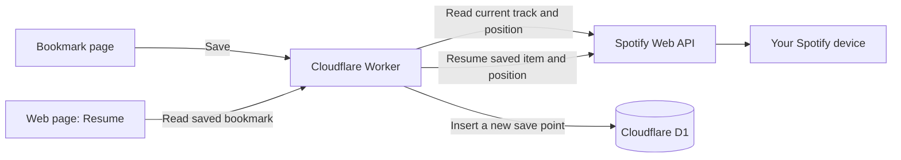

# Spotify Album Bookmarks

**Add a save point for any moment in your Spotify listening.**

A small, self-hosted app for keeping independent save points, like video game saves, across music and podcasts. **Add bookmark** creates a new entry; **Update position** replaces one selected save with your current playing or paused audio and time, keeping its name. Choose a device under **Where to play**, then tap the bookmark's **Resume** button. On iPhone, choosing **This iPhone** lets that same tap open Spotify and resume the saved position.

For example: create **Gym** and **Evening listening**, even in the same album, plus a podcast at **23:45**. Update **Gym** after your next session, or add a new save to keep both positions. Updates can replace the audio too: a slot is not tied to one album or episode. Each entry has its own Resume, Update position, Name/Rename, and Delete actions.

This is a personal app for **one Spotify account per deployment**. You host your own copy and connect your own Spotify developer app. It is independent of Spotify.

## What you get

- A flat, mobile-friendly shelf with named bookmarks that you can add, update, resume, or delete individually.
- Open the page with your existing Home Screen shortcut; add, update, and resume directly in the app.
- Resume on your active Spotify player, or choose a computer, phone, or speaker under **Where to play**.
- One-tap iPhone resume: **This iPhone → Resume** opens Spotify directly. No second in-app confirmation button or separate API Shortcut is needed.
- Resume supplies the original album/playlist or parent podcast show, the exact saved track/episode, and its time together. Podcast resume also checks the reported episode, device, playback status, and position before confirming success.
- Private bookmarks stored in your own Cloudflare Worker and D1 database.

**Saving is manual.** The app does not continuously track your listening or pause Spotify when you bookmark. It does not download or stream audio; playback stays in Spotify.

## Everyday use

After connecting your Spotify account:

| What you want to do | Use |
| --- | --- |
| Keep a new moment | **Add bookmark** while the music or podcast is playing or paused |
| Move an existing save to your current position | That bookmark's **Update position**; its name stays the same |
| Give a save a useful label | **Name** or **Rename**, such as Gym or Evening listening |
| Return to a save | Choose a device under **Where to play**, then tap **Resume** on that bookmark |
| Resume on the iPhone you're using | Choose **This iPhone**, tap **Resume**, and keep Spotify visible while playback starts |

You can keep several saves in the same album, playlist, or episode. Use **Add bookmark** when you want to preserve an older position; updating replaces it and has no undo. Saving or updating does not start playback. Spotify must still report the item and position, even when paused.

Tap **Update position** directly on the bookmark to replace its audio and time, playing or paused, while keeping its name. On iPhone, that same tap opens Spotify and completes the save automatically while Spotify is visible. There is no recovery choice or second Save button. If Spotify supplies no state, the app may reconnect the phone without sending Play. Reconnection can change the queue; the bookmark records the audio and position Spotify reports. Missing or invalid data leaves the earlier save unchanged.

## How it works



For **Add bookmark**, the Worker reads Spotify's current playback state, including paused state, and gives the new bookmark a random ID. It never uses an album, playlist, or episode ID to decide whether to overwrite a save. Several bookmarks can point to the exact same item or moment.

**Update position** explicitly replaces the chosen slot's audio metadata and time, preserving its ID, name, creation date, and place in the list. Other saves are untouched. Invalid or unavailable playback leaves the existing save unchanged. The shelf shows creation and edit dates; edits include both name and position changes. There is no undo/history for a replaced position, so use Add bookmark when you want to keep the earlier one.

Source details are retained to resume the right audio: music records its album/playlist context and track, while podcasts record the episode. After adding a bookmark, use **Name** or **Rename** to give it an optional label of up to 120 characters. Renaming changes only the label, not its audio, timestamp, or place in the list. Clearing the label restores the automatic item/time title.

For music, resume sends the album/playlist URI, track URI offset, and saved time together. Using the track URI supports multi-disc albums. For podcasts, it sends the parent show URI as context, the exact episode URI as offset, and the saved time. Older episode bookmarks resolve their parent show from Spotify when resumed; their saved positions and names stay unchanged.

The show-context method was verified on the original Windows desktop with two episodes from different shows. Spotify's [published playback reference](https://developer.spotify.com/documentation/web-api/reference/start-a-users-playback) does not explicitly document show contexts, so other clients still need a real playback check. The bare episode-URI method returned success on that desktop while clearing playback. The app now checks the actual podcast playback state and reports an error if it cannot confirm the episode at the saved position.

Playlist names are fetched when Spotify permits it. If metadata is unavailable, the app keeps a previously known name or shows a stable label such as **Playlist abc123**. Saving the position does not require extra playlist permissions.

Spotify sign-in uses PKCE and requests `user-read-playback-state` and `user-modify-playback-state`. No Spotify client secret is needed.

## Requirements

- **Spotify Premium**, required by Spotify's [playback-control endpoint](https://developer.spotify.com/documentation/web-api/reference/start-a-users-playback).
- Your own [Spotify developer app](https://developer.spotify.com/dashboard) with Web API access and your account permitted to use it. App eligibility and development limits follow Spotify's [current quota-mode rules](https://developer.spotify.com/documentation/web-api/concepts/quota-modes).
- **Node.js 24 or later**, npm, and Git for local development.
- A **Cloudflare account** with Workers and D1 access for hosting. Check your plan's limits and usage; this project does not guarantee free hosting.
- Safari and the Spotify app for the iPhone resume flow. A Home Screen launcher is optional.

## Run locally

### 1. Get the project

```sh
git clone https://github.com/jtdelosh-ops/spotify-album-bookmarks.git
cd spotify-album-bookmarks
npm ci
cp .env.example .dev.vars
```

In Windows PowerShell, `Copy-Item .env.example .dev.vars` also works.

### 2. Configure Spotify and your keys

Add this exact redirect URI to your Spotify developer app:

```text
http://127.0.0.1:8787/auth/spotify/callback
```

Spotify allows HTTP for explicit loopback IPs but does not accept `localhost` as a redirect URI. See its [redirect URI requirements](https://developer.spotify.com/documentation/web-api/concepts/redirect_uri).

Edit `.dev.vars`:

| Variable | Value |
| --- | --- |
| `APP_ORIGIN` | `http://127.0.0.1:8787`, no trailing slash |
| `SPOTIFY_CLIENT_ID` | Your app's public Client ID |
| `ENCRYPTION_KEY` | A new 32-byte key in standard base64 |
| `SETUP_KEY` | A separate random key for signing in to your instance |

Generate the keys separately:

```sh
# ENCRYPTION_KEY
node -e "console.log(require('node:crypto').randomBytes(32).toString('base64'))"
# SETUP_KEY
node -e "console.log(require('node:crypto').randomBytes(32).toString('base64url'))"
```

Keep both private and recoverable. `.dev.vars` is ignored by Git. Enter the **setup key** on the sign-in page; the **encryption key** stays on the server and is never entered on that page.

### 3. Start the app

```sh
npm run db:local
npm run dev
```

Open [127.0.0.1:8787](http://127.0.0.1:8787), enter your setup key, and authorize Spotify. The first account to complete sign-in becomes the owner. Later sign-ins require that same account and the setup key. Reconnecting ends existing browser sessions and preserves bookmarks.

Open a music track or podcast episode, playing or paused, and tap **Add bookmark**. To resume, use the active player or tap **Refresh devices**, select a device under **Where to play**, and tap **Resume** on a bookmark. Choosing another device may move playback there.

Your iPhone cannot use the computer's loopback address. Deploy an HTTPS instance before using the app from your phone.

## Host your own copy

Follow the [deployment guide](docs/deployment.md) for database creation, secrets, and the Spotify HTTPS callback.

Start with **[`wrangler.production.example.jsonc`](wrangler.production.example.jsonc)** and enter your own account, database, hostname, and Client ID. The checked-in `wrangler.production.jsonc` identifies the original deployment; it is not a configuration for someone else's account. `npm run deploy` uses that production file, so configure it before deploying.

The guide also covers updates, backups, and key recovery.

## Resume on your iPhone without pressing Play first

1. Open the HTTPS bookmark page using your existing Home Screen shortcut or Safari.
2. Choose **This iPhone** under **Where to play**, then tap **Resume** on the saved bookmark.
3. Spotify opens from that same tap. Allow the iOS open-app prompt if shown, and keep Spotify on the screen while the saved audio starts at its bookmarked position.

Each bookmark has one **Resume** button. **This iPhone** is the default choice on iPhone and stays in the dropdown when Spotify hides an idle phone. The app remembers the successfully used phone in that browser for up to 30 days. On first use, it waits for one new phone to appear after Spotify opens. If a phone is already listed and has not been remembered, select it by name to resume directly. It refuses to choose between multiple new phones. Select **Active Spotify device** or a listed speaker/computer for ordinary remote playback. Refreshing keeps a selected device even if it becomes unavailable, so it cannot silently switch playback elsewhere. No extra Shortcut key is needed.

A paused iPhone can disappear from Spotify Connect when Spotify moves to the background. **Resume** opens Spotify and starts the saved-position request during the same tap. Opening Spotify makes the phone reachable; the Worker sends the bookmarked audio and time while Spotify is in front. The phone flow checks actual playback before confirming success. For first discovery, the app needs a device list from the last minute; if it is missing or stale, Resume refreshes it and asks you to tap again, without opening Spotify or sending a playback command. The list also refreshes when you return to the page. A remembered phone uses its exact ID without that discovery preflight. Slow networks, a closed/uninstalled Spotify app, or a changed device ID can still prevent confirmation; check Spotify before retrying.

**Add bookmark** and **Update position** also work with paused playback, provided Spotify still reports the item and position. They do not start audio. Your existing Home Screen launcher is sufficient; no separate Shortcut credential is needed. See the [iPhone guide](docs/iphone-setup.md) for device discovery and troubleshooting.

## Behavior and limitations

- **Playing and paused saves are supported.** Spotify must still report a supported track/episode and a valid position. Closed/offline devices may return no state. Missing data, local files, ads, and audiobook chapters are rejected without overwriting a bookmark.
- **Add and update are separate actions.** Add creates another entry; Update position replaces only the selected save. Neither runs automatically.
- **Timing is approximate.** Capture uses Spotify's reported position; network and device delays affect capture and resume.
- **Devices must be available to Spotify.** Explicit selection can target an available idle device, but cannot guarantee waking a closed app or reaching an offline device.
- **Shuffle and repeat stay as you set them.** Shuffle can change which track follows the bookmarked one.
- **Availability can change.** Removed/relinked tracks, regional restrictions, and restricted devices can prevent resume.
- **Reconnection may be needed.** If Spotify authorization expires or is revoked, reconnect with the original owner. Bookmarks remain.
- **One owner per instance.** There is no account switching or ownership-transfer interface. Use a separate instance/database for another account.

## Privacy and security

Spotify access and refresh tokens stay on the server, encrypted in D1 with AES-256-GCM. Bookmark metadata and positions are stored in D1; they are not encrypted by the application. Browser sessions use HttpOnly cookies, and mutations require origin and CSRF checks. Advanced legacy API clients can use hashed, revocable Shortcut credentials; normal use of the website needs no such credential.

iPhone updates briefly store an encrypted, session-bound capture in D1 so the save can finish while Safari is backgrounded. The Worker commits that snapshot automatically and clears it on success. Jobs expire after five minutes; daily cleanup or the next update removes expired rows. Legacy Shortcut permissions do not change.

**Disconnect Spotify** removes stored Spotify credentials, ends browser sessions, and revokes Shortcut access. It retains bookmarks and the owner binding. To revoke Spotify's grant itself, also remove the app in Spotify's account app-access settings.

Never commit `.dev.vars`, `.env.production`, database exports, or populated Shortcut files. The [security guide](docs/security.md) explains retention, recovery, and trust boundaries.

## Troubleshooting

| Symptom | What to do |
| --- | --- |
| No active device, even though Spotify is open | **Refresh devices**, choose the intended device under **Where to play**, then Resume. If absent, open Spotify there and refresh. |
| Idle iPhone is missing from the device list | On the iPhone, choose the persistent **This iPhone** entry and tap **Resume**. Keep Spotify visible after it opens. If the app cannot identify the phone on first use, follow its refresh/device-selection message. |
| Nothing saves | Open a supported track or podcast episode using the connected account. Playing or paused is fine; Spotify must still report its position. |
| Updating a paused iPhone | Tap **Update position** on the bookmark and keep Spotify visible while it saves automatically. If Spotify supplies no valid position, the bookmark stays unchanged. |
| Podcast playback is not confirmed | Open the saved episode in Spotify or choose another available device, then retry Resume. The app keeps the bookmark and does not skip through your queue. A timeout means playback could not be confirmed; check Spotify before retrying. |
| Sign-in fails | Check the setup key, original owner account, app access, and exact callback. Both playback permissions are required. |
| Reconnect requested | Authorize the same account again. Your bookmarks remain. |
| Rate limit or quota error | Respect `Retry-After` if provided. Repeated attempts do not fix quota exhaustion. |
| `spotify_busy` | Credential refresh is in progress. Try again after a short pause. |
| Lost encryption key | Follow the [recovery procedure](docs/deployment.md#lost-key-or-token-compromise-recovery), then reconnect. Existing encrypted credentials cannot be recovered without their key. |

## Development

TypeScript Worker, plain HTML/CSS/JavaScript, and D1 SQL. No frontend framework or npm runtime dependencies.

| Command | Purpose |
| --- | --- |
| `npm run dev` | Run locally at `127.0.0.1:8787` |
| `npm run db:local` | Apply local D1 migrations |
| `npm run typecheck` | Check TypeScript |
| `npm test` | Run Node tests with in-memory SQLite and mocked Spotify responses |
| `npm run build` | Bundle a dry run; does not publish |
| `npm run deploy` | Publish using `wrangler.production.jsonc` |

| Location | Contents |
| --- | --- |
| `src/index.ts` | Routes, owner/session checks, bookmarks, and device selection |
| `src/spotify.ts` | Spotify requests, token refresh, automatic context selection, and resume payload |
| `src/phone-resume.ts` | Bounded phone discovery, exact-device resume, and playback confirmation |
| `src/paused-recovery.ts` | Browser-only paused capture, temporary encrypted preview, and explicit confirmation |
| `src/crypto.ts` | Encryption, credential generation, and hashing |
| `public/` | Web interface |
| `migrations/` | D1 database schema |
| `tests/` | Application tests; not a substitute for real device checks |
| `docs/` | Deployment, iPhone/Home Screen guides, API reference, security, and verification |

See the [API reference](docs/api.md) for integration details and the [manual verification plan](docs/manual-test-plan.md) before a release.

### Verification on the original deployment

As of 26 October 2026:

| Area | Evidence and scope |
| --- | --- |
| One-tap iPhone music resume | The owner confirmed on a physical iPhone that **This iPhone → Resume** opens Spotify and resumes the selected music bookmark at its saved position, with no second in-app button. |
| Desktop podcasts | Direct live playback-function checks on Windows confirmed episodes from two shows and show lookup for an older episode bookmark. This is narrower than a complete hosted podcast save/resume check. |
| Device routing and safeguards | Local browser checks with actual app routes and a synthetic Spotify provider covered first/remembered phone targeting, speakers, missing devices, keyboard activation, and duplicate-click suppression. These do not establish native iPhone app opening by themselves. |

The iPhone result is an owner-reported device check, not an independently observed test across all clients. Other iOS/Spotify versions, iPhone podcast resume, and a complete device matrix remain unverified. Browser checks and compilation do not replace real playback checks on your intended device.

Paused-update recovery was added on 27 October 2026. The owner confirmed the hosted flow worked on a physical iPhone without pressing Play. Local checks exercise the actual routes and SQLite with a synthetic Spotify provider, including capture/review/confirm, cancellation, expiry, changed slots and session isolation. A 390-pixel browser preview checks reload/confirmation behavior. The unified **Update position** action removes the recovery choice and manual confirmation. Playing/paused automatic saves are checked locally with the actual routes and SQLite; this revised automatic flow still needs a physical-device check.

Pull requests and pushes to `main` run **Typecheck and build** in GitHub Actions. This checks compilation and Worker packaging; it does not run the application test suite, use Spotify credentials, or deploy to Cloudflare.
